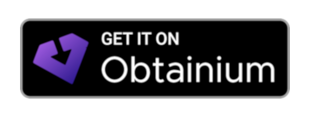

## QuaX v4.24.0

What's new in QuaX v4.24.0:
  - Moved the Flutter update routine out of the repository <sup>[[view modified code]](https://github.com/teskann/quax/commit/81bde3684637d36b483c968173bea48bc9abea1c)</sup>
  - Restoring backups keeps the order saved posts were saved in (fixed #409) <sup>[[view modified code]](https://github.com/teskann/quax/commit/f60d7fdff64e35fdfc8e9bc2209784d4026b2d52)</sup>
  - Bug reports for errors returned by X now include every detail X gave about them, for better context <sup>[[view modified code]](https://github.com/teskann/quax/commit/6762aac9f7eafa78cb83aa85290b3507c6e09c87)</sup>
  - Attempted to reduce the risk of your account being suspended for using it with QuaX (#422) <sup>[[view modified code]](https://github.com/teskann/quax/commit/689db2c9c2b8c332e3c533dfa1e5490d91c6ad5b)</sup>
  - Authentication cookies are now stored encrypted, with a key that never leaves the device <sup>[[view modified code]](https://github.com/teskann/quax/commit/a5f3f5adae4681bb3d67aee226e30669fdc0f973)</sup>
  - Exported accounts are now encrypted with a password chosen by the user <sup>[[view modified code]](https://github.com/teskann/quax/commit/1015ead14345dc8025623b6a284ad8f5c7b09330)</sup>


---

⚠️ Several users got their X account suspended after using it with QuaX. This update should reduce the likelihood of being spotted, but it's not guaranteed. It's highly recommended to use QuaX with a dummy account to avoid having your real account suspended.

---

First download ? Click the button below to install it with Obtainium ! 👇

[](https://apps.obtainium.imranr.dev/redirect?r=obtainium://add/https://github.com/Teskann/QuaX)

APK Certificate fingerprints:
```text
SHA1: B4:8C:12:75:81:4D:94:8D:84:00:32:D5:45:EE:06:A9:3E:0A:2D:BE
SHA256: 5E:39:1A:AA:89:9A:0B:21:A5:29:6A:4C:26:DB:50:12:7E:B8:40:63:6A:2A:35:18:14:16:75:3F:AB:1C:17:C3
```

---

Missed an update ? See [full changelog](https://github.com/teskann/quax/blob/master/changelog.md) for more details.
    
[](https://discord.gg/K7UHuywPWD)

👉 Read the [wiki](https://github.com/teskann/quax/blob/master/docs/QuaX.md) to learn more about the app and how it works.
